# AcademicOS على iPhone Duo — جودة الامتداد الكامل والتكيّف (13 نوفمبر 2026)

نطاق هذه الجولة طبقة العرض فقط: ملف جديد [src/duo-edges.css](../src/duo-edges.css) يُحمَّل أخيرًا، وتوسيع استعلامات [src/duo.css](../src/duo.css) و[src/beauty.css](../src/beauty.css)، وسطر في [src/components/ErrorBoundary.tsx](../src/components/ErrorBoundary.tsx) (نقل الارتفاع والحشو من `style` إلى صنف CSS)، واختبارات حراسة في [tests/duo-layout.test.ts](../tests/duo-layout.test.ts). لم يُمَسّ الخادم ولا المصادقة ولا البيئة التجريبية ولا Firestore ولا الدفع ولا الدرجات ومنطق التقييم ولا بيانات الطلاب ولا ملفات النشر ولا غلاف iOS.

رموز الحالة: `PASS` تحقق مُشاهد أو مُقاس، `PARTIAL` جزئي، `FAIL` خلل باقٍ، `BLOCKED` يحتاج جهازًا أو إذنًا، `NOT_APPLICABLE` غير ذي صلة، `NOT_TESTED` لم يُختبر.

ملاحظة عن المرجع: ملف التعليمات الرئيسي `~/Desktop/00_MASTER_CLAUDE_CODE_AR.txt` لم يكن موجودًا على القرص وقت العمل. اعتمدت تعريفات الوضعيات A–J كما وردت في جولة أوربت، و`DUO_BRIEF.md` و`RUN_2026-11-13.md`.

## 1. نوع المشروع ومسار العرض

- **الويب:** React 19 + Vite 6 + Tailwind 4، يخدمه Express ([server.ts](../server.ts)). الواجهة غلاف تطبيق واحد (`.app-shell`: شريط علوي، و«شريط أيقونات» جانبي بين 600 و1023px، وقائمة سفلية تحت 600px، وشريط جانبي كامل من 1024px)، وصفحات عامة (`.public-shell` و`.public-page` و`.auth-shell`).
- **الطبقات:** `index.css` ← `identity.css` ← `motion.css` ← `final-polish.css` ← `duo.css` ← `beauty.css` ← **`duo-edges.css` (جديد)**.
- **PWA:** `viewport-fit=cover` و`apple-mobile-web-app-status-bar-style: black-translucent`. أي أن الصفحة تطلب الشاشة كاملة وتمتد تحت شريط الحالة في التطبيق المثبّت.
- **ما كان على main قبل هذه الجولة:** جولات Duo/Beauty من 1 إلى 10 (شريط الأيقونات، تذييل الشريط المثبّت، أهداف لمس 44px تحت 640px، إلخ). لم أُعِد بناء شيء منها.

## 2. خط الأساس قبل التعديل (`origin/main` = `921da63`)

| الفحص | النتيجة |
|---|---|
| `npm ci` | PASS |
| `npm run lint` (`tsc --noEmit`) | PASS |
| `npm run test:ci` (20 ملف اختبار) | PASS: 224/224 |
| `npm run build` | PASS |
| مصفوفة WebKit قبل (151 لقطة: 12 مقاسًا × حتى 19 شاشة) | 0 تمرير أفقي، 0 عناصر خارج الشاشة، 0 أخطاء تحميل. عيوب التكوين في القسم 3 |

لم يكن أي فشل موجودًا قبل التعديل.

## 3. ما وُجد وما أُصلح من جذوره

| # | العَرَض (قبل) | الجذر | الإصلاح |
|---|---|---|---|
| 1 | **B مطوي عرضي 594×368:** شريط علوي (64px) وقائمة سفلية عائمة (~70px) يتركان **233px** للمحتوى. يظهر عنوان الصفحة وحده ثم تغطيه القائمة | التحول إلى الشريط الجانبي يقرره العرض فقط (`min-width: 600px`)، و594 أقل منه بقليل | قاعدة آبل للارتفاع المضغوط: كل استعلام `(min-width: 600px) and (max-width: …)` في `duo.css` و`beauty.css` (20 استعلامًا) أُضيف إليه `(min-width: 520px) and (max-width: 599.98px) and (max-height: 480px)`. فالمطوي عرضيًا يأخذ الشريط الجانبي ويختفي الشريط السفلي. **المساحة للمحتوى صارت 304px (+30%)**. الطولي 382×580 والـSplit 470 لم يتغيرا |
| 2 | **الدخول في الارتفاع القصير:** على 594×368 يقع حقل البريد عند حافة الشاشة، وعلى 951×350 (مفتوح عرضي مع لوحة مثبتة) لا يظهر أي حقل في الشاشة الأولى | صف كامل لمبدّل اللغة، ورابط «الرئيسية» بهامش 24px، وأيقونة قفل 48px، وحشو علوي 64px من 768px | `@media (max-height: 480px)`: حشو أدق، وإخفاء أيقونة القفل الزخرفية، والمبدّل بجانب البطاقة تحت 768px بدل صف مستقل. على 594×368 يظهر الحقلان، وعلى 951×350 حقل البريد كاملًا وبداية كلمة المرور |
| 3 | **حواف الأمان في RTL:** المحتوى على الجهة **اليسرى** (نهاية السطر في العربية) لا يبتعد أبدًا عن الكاميرا أو الزاوية المدورة، لا في الشريط العلوي ولا في المحتوى ولا في الصفحات العامة. وشريط الأيقونات يضيف حافة **اليسار** على الجهة **اليمنى** في RTL (`padding-inline: env(left) env(right)`) | لا توجد tokens للحواف، وكل مكوّن يكتب `env()` بنفسه، والجهات المنطقية لم تُربط بالفيزيائية | tokens `--sa-t/r/b/l` و`--sa-start/--sa-end` تنقلب في `[dir="rtl"]`. الشريط الجانبي يأخذ حافة البداية، والمحتوى والشريط العلوي يأخذان حافة النهاية، وتحت 600px يأخذ كل جانب حافته. القائمة السفلية `left/right` فيزيائيان. الصفحات العامة: الحشو داخل الحاويات، فتبقى الخلفيات والأشرطة الملونة ممتدة حتى الحافة. لا فرق بصري حين تكون الحواف صفرًا |
| 4 | مبدّل اللغة في صفحة الدخول من 768px موضوع بـ`absolute` على بعد 16px من الحافة، فلا يتأثر بأي حشو (ظهر عند x=16 في محاكاة نتوء 47px) | التموضع المطلق يتجاهل الحشو | `top/inset-inline-end` تحسب `--sa-t/--sa-end` |
| 5 | الصفحات العامة وشاشة الخطأ و`MfaSetup` بارتفاع `100vh` | في Safari هو ارتفاع الشاشة مع إخفاء شريط الأدوات، فالمحتوى المتوسَّط ينزل تحت المنتصف | `:where(.min-h-screen), .public-page, .error-screen` ← `100dvh` (و`.auth-shell` يبقى على `100svh` الموجود) |
| 6 | شاشة الخطأ (ErrorBoundary) بحشو ثابت 24px و`100vh` في `style` | قيم مضمنة لا تعرف الحواف | صنف `.error-screen` بالحواف الأربع و`100dvh` |
| 7 | من 640px على شاشات اللمس: قائمة اللغة في الصفحات العامة هدف لمس **27px**، وقائمة الدور في البيئة التجريبية 24px | قاعدة الـ44px موجودة تحت 640px فقط | `@media (pointer: coarse)`: الكبسولة 44px على أي عرض. القياس بعده: 0 أهداف صغيرة في كل المقاسات اللمسية. سطح المكتب بالفأرة يبقى مضغوطًا عمدًا |
| 8 | من 600 إلى 639px (وفي B بعد الإصلاح 1): شعاران «A» متجاوران، في الشريط الجانبي وفي الشريط العلوي | شعار الشريط العلوي `sm:hidden` يظهر تحت 640px دون اعتبار لوجود الشريط الجانبي | يُخفى شعار الشريط العلوي حين يظهر الشريط الجانبي: شعار واحد في الشاشة |
| 9 | الشريط العلوي يأخذ `safe-area-inset-top` عبر `env()` مباشرة | مصدران للقيمة | صار عبر `--sa-t` (النتيجة على الجهاز مطابقة، لكنه صار قابلًا للمحاكاة والاختبار) |

## 4. فحص الامتداد الكامل

| البند | الحالة | الدليل |
|---|---|---|
| خلفية الجذر والأشرطة | PASS | `.app-shell`/`.public-shell`/`.auth-shell` بخلفية `--bg` حتى الحواف، والحشو داخل الحاويات فقط |
| الحواف الأربع (محاكاة tokens) | PASS (محاكاة) | WebKit في Playwright يعيد `env()` = 0، فحقنت قيمًا في `--sa-*` وقست أقرب نص أو زر للحافة: 12 حالة (آيفون عرضي 844×390 بنتوء 47/47، مطوي عرضي 594×368 بحافة 40 يمين، مطوي PWA 382×580 بشريط حالة 44) × 4 شاشات = **0 تداخل**. الجولة الأولى من هذه المحاكاة كشفت تداخلين صُحّحا في الإصلاحين 4 و9. على main القديم لا توجد tokens تُحاكى، والحكم هناك من قراءة الكود (الإصلاح 3) |
| تمرير أفقي | PASS | 0 في كل اللقطات قبل وبعد |
| `overflow: hidden` على الجذر | PASS | غير مستخدم (`.public-shell { overflow: clip }` لزخارف البطل فقط) |
| عمود أزرار Safari الجانبي في المطوي | NOT_APPLICABLE | لا يستطيع CSS مد المحتوى خلفه |
| لوحة المفاتيح | NOT_TESTED | لا لوحة مفاتيح حقيقية في المحاكاة |

## 5. مصفوفة الوضعيات A–J

المنصة: Playwright WebKit (Playwright 1.64.1) بملف Safari المحمول للـDuo (UA، لمس، DPR 2، تقليل الحركة، `ar-KW`). الشاشات: عامة (الرئيسية، الدخول، الحالة، التحقق)، خطأ (رابط مشاركة غير صالح، مشروع غير موجود)، طالب (الرئيسية، المشاريع، تعلّم، الجواز، الإشعارات)، أستاذ (الرئيسية، مساحة الأستاذ، التقويم، الأرشيف، الإعدادات)، إدارة (الرئيسية، المستخدمون، لوحة المؤسسة). الأدوار عبر البيئة التجريبية المعزولة فقط.

| الوضعية | المقاس | الطالب | الأستاذ | الإدارة | العامة والدخول | الخطأ والفراغ | الحالة |
|---|---|---|---|---|---|---|---|
| A مطوي طولي | 382×580 | ✓ | ✓ | ✓ | ✓ | ✓ | PASS (محاكاة)، بلا تغيير مقصود |
| B مطوي عرضي | 594×368 | شريط جانبي، 304px للمحتوى (كانت 233) | ✓ | ✓ | الحقلان ظاهران | ✓ | PASS (محاكاة) بعد الإصلاح 1 و2 |
| C مفتوح طولي | 669×867 | ✓ | ✓ | ✓ | ✓ | ✓ | PASS (محاكاة) |
| D مفتوح عرضي | 951×585 | ✓ | ✓ | ✓ | ✓ | ✓ | PASS (محاكاة) |
| E كتاب | مفصل عمودي | — | — | — | — | — | BLOCKED: Viewport Segments خلف علم في Safari 27.1، واختبار المستودع يمنع عمدًا أن يقرر الطي التخطيط (`duo-layout.test.ts`). لم أُضف كتل segments |
| F طاولة | مفصل أفقي | — | — | — | — | — | BLOCKED: للسبب نفسه |
| G نافذتان | 385×571 | ✓ | ✓ | ✓ | ✓ | ✓ | PASS (محاكاة) |
| H Split | 320 / 470 / 620 ×600 | ✓ | ✓ | ✓ | ✓ | ✓ | PASS (محاكاة). 620: شعار واحد بدل اثنين |
| I خيمة/حامل | — | — | — | — | — | — | NOT_TESTED: لا runtime يعلن الوضعية |
| J انتقال حي | 951→669→470→382→594×368→951 | النص المكتوب باقٍ، 0 إعادة تحميل، 0 تمرير أفقي، والتبديل بين الشريط الجانبي والقائمة السفلية لحظي | | | | | PASS |

مقاسات إضافية: 669×520 (مثبت أعلى)، 951×350، 390×844، 1440×900: 0 تمرير أفقي. 951×350: حقل البريد صار في الشاشة الأولى.

## 6. صور قبل/بعد

| الحالة | قبل | بعد |
|---|---|---|
| B مطوي عرضي، رئيسية الطالب | 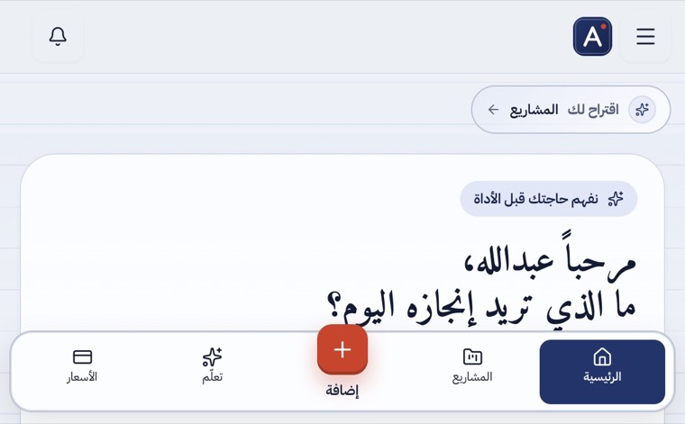 | 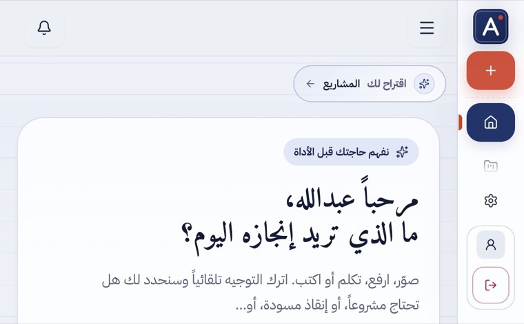 |
| B مطوي عرضي، الدخول | 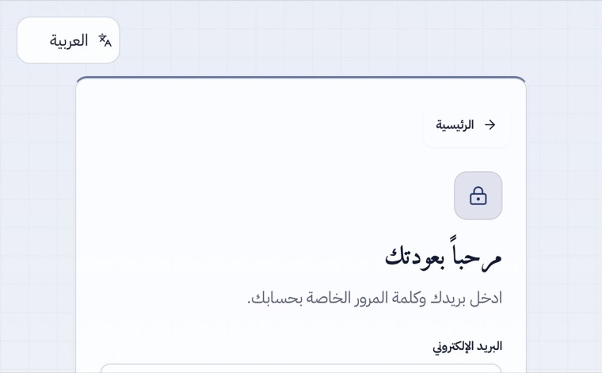 | 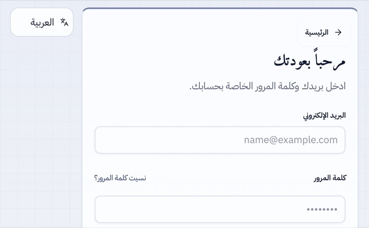 |
| 951×350، الدخول | 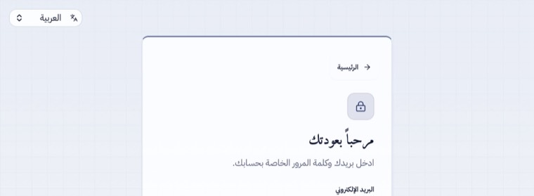 | 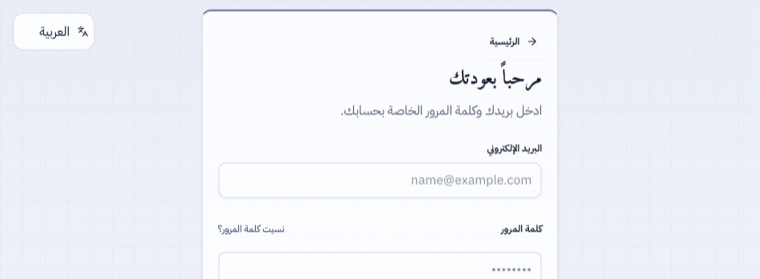 |
| H 620، شعار مكرر | 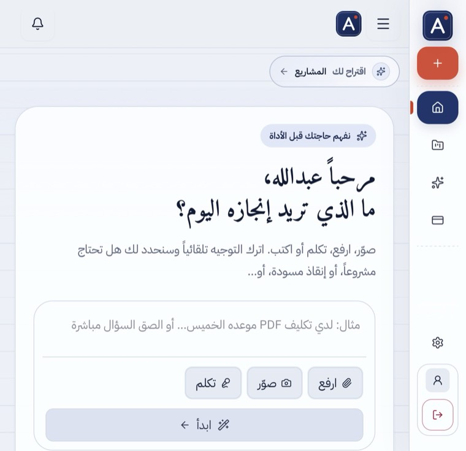 | 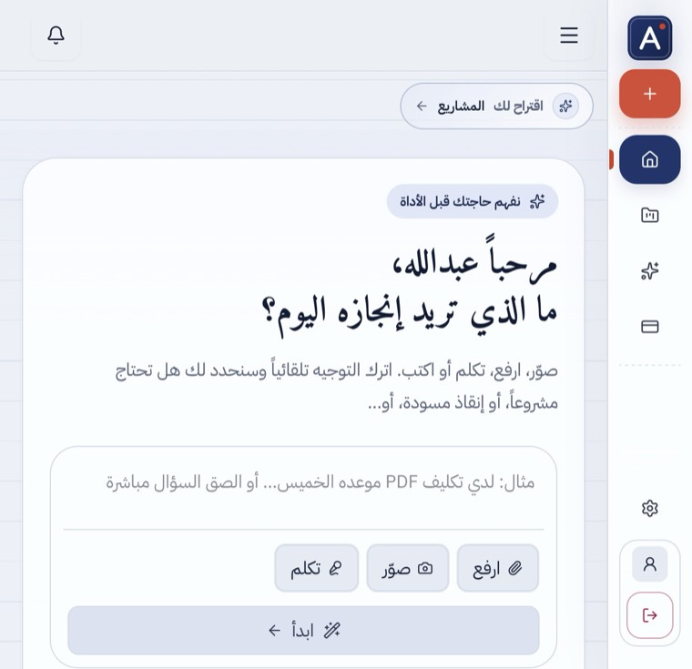 |
| محاكاة نتوء 47px، الدخول 844×390 (بعد) | | 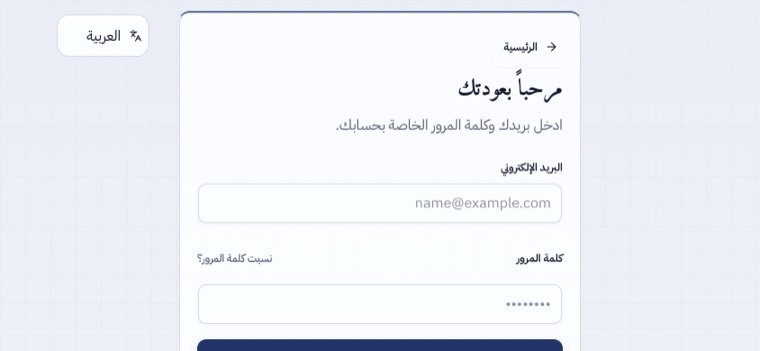 |
| A و C و D بعد (بلا تغيير مقصود) | 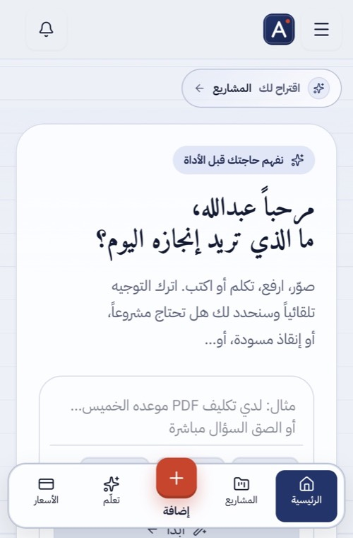 | 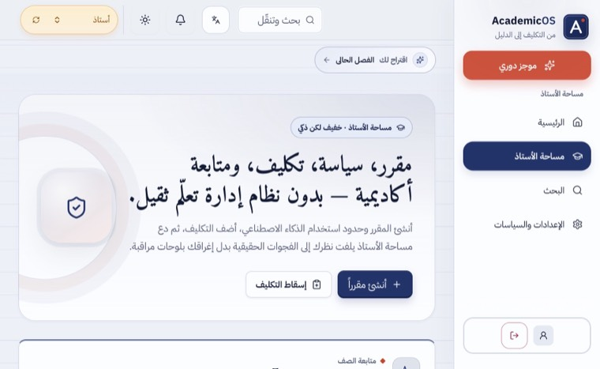 |

## 7. الوصول والاتجاه

- RTL: كل الشاشات `dir=rtl`، والحواف المنطقية تنقلب مع الاتجاه. PASS.
- التكبير غير مقفول (`width=device-width, initial-scale=1.0, viewport-fit=cover`)، و`touch-action: manipulation`. PASS (يحرسه اختبار).
- أهداف اللمس: 0 أهداف أقل من 32px في كل المقاسات اللمسية بعد الإصلاح 7، عدا حقل ملف مخفي بصريًا (1×44px) في `/verify-evidence` هدفه الحقيقي هو الـ`label` الظاهر (ليس عيبًا). على سطح المكتب بالفأرة تبقى قائمة اللغة 27px (مقبول بمعيار WCAG 2.5.8: ≥24px). PASS.
- تقليل الحركة: لا حركة جديدة. PASS.
- VoiceOver حقيقي: NOT_TESTED.

## 8. الأداء

CSS فقط (+~170 سطرًا غير مضغوطة)، ولا JavaScript جديد ولا مراقبو resize. لم تُقس Core Web Vitals (التشغيل المحلي تحت حمل جهاز مرتفع لا يمثل الإنتاج): NOT_TESTED.

## 9. الاختبارات بعد التعديل

| الأمر | النتيجة |
|---|---|
| `npm run lint` | PASS |
| `npm run test:ci` | PASS: 228/228 (224 + 4 اختبارات حراسة جديدة: tokens الحواف وانقلابها في RTL وترتيب التحميل، والارتفاع المضغوط في كل استعلامات الشريط الجانبي، والدخول القصير وأهداف اللمس، و`100dvh`؛ ومنع posture/segments صار يشمل `beauty.css` و`duo-edges.css`) |
| `npm run build` | PASS، والقواعد الجديدة موجودة في CSS المبني |
| مصفوفة WebKit بعد | 0 تمرير أفقي، 0 عناصر خارج الشاشة |
| محاكاة الحواف | 0 تداخل في 12 حالة |
| الانتقال الحي J | PASS |

ملاحظة للتشغيل المحلي: الخادم يرسل `upgrade-insecure-requests` وHSTS، فيرفض WebKit تحميل الأصول عبر `http://localhost`. سكربت اللقطات يحذف الترويستين داخل المتصفح الاختباري فقط؛ لم يُغيَّر الخادم.

## 10. القيود وما يجب فحصه على جهاز حقيقي

1. Playwright ليس جهازًا: الحواف الحقيقية وعمود Safari الجانبي ولوحة المفاتيح لم تُقس. الحواف اختُبرت بمحاكاة الـtokens.
2. على Duo: (أ) أمسك الشاشة المطوية عرضيًا (~594×368): هل يظهر الشريط الجانبي بدل القائمة السفلية؟ (ب) صفحة الدخول في الوضع نفسه: هل الحقلان ظاهران دون تمرير؟ (ج) ثبّت التطبيق على الشاشة الرئيسية (PWA) وافتحه مطويًا: هل الشريط العلوي تحت شريط الحالة لا خلفه؟ (د) آيفون عرضي: هل نص الصفحة والشريط العلوي بعيدان عن النتوء في الجهتين؟
3. E/F: Viewport Segments خلف علم، والمستودع يمنع قصدًا أن يقرر الطي التخطيط. BLOCKED حتى يتغير أحدهما.
4. الأعداد في B (233 ← 304px) من قياس WebKit لنافذة 594×368.

## 11. جاهزية Native

مجلدا `apple/` و`apple-release/` لم يُمسّا. الغلاف يحمّل الموقع، فكل ما سبق يصله بعد النشر.

## 12. النشر

`main` لا ينشر تلقائيًا: سير العمل «نشر AcademicOS إلى Cloud Run» (`deploy-cloud-run.yml`) يعمل بـ`workflow_dispatch` فقط منذ 2026-10-28. انظر تقرير الجولة للحالة.
