# AcademicOS على iPhone Duo — قبول الجولة النهائية (14 نوفمبر 2026)

> «وضع الكتاب»: الشاشة الداخلية صفحتان حول كعبٍ هادئ، لا صفحة آيباد ممطوطة.
> طبقة العرض فقط (CSS ووسوم عرض)، دون أي تغيير في المنطق أو البيانات أو المسارات أو النصوص.

رموز الحالة: `PASS` مُقاس ومُشاهَد، `PARTIAL` يعمل مع ملاحظة مسجّلة، `FAIL` خلل باقٍ، `BLOCKED` لا يمكن الوصول، `NOT_TESTED` لم يُختبر.
لم يُختبر أي شيء على جهاز حقيقي. كل القياسات من Playwright WebKit على بيئة تجريبية معزولة (`/api/demo/session`، قراءة فقط).

## 1. ما تغيّر

| الملف | التغيير |
|---|---|
| [src/duo-edges.css](../src/duo-edges.css) | الأقسام 7–9 الجديدة: «وضع الكتاب» للتطبيق وللصفحات العامة، و«وضع اللابتوب»، وكلها `screen` فقط (الطباعة لا تتأثر) |
| [src/beauty.css](../src/beauty.css) | استعلاما «الجولة 8» (تذييل الشريط المثبّت) لا يعملان داخل وضع الكتاب — إصلاح ترتيب من الجذر بدل `!important` |
| [src/components/Layout.tsx](../src/components/Layout.tsx) | غلاف `topbar-tools` بـ`display: contents` حول أدوات الشريط العلوي: لا أثر له في أي مقاس، وفي وضع الكتاب ينتقل كتلةً واحدة إلى الصفحة اليسرى |
| 13 صفحة (`MissionControl`, `ProfessorOS`, `RoleHome`, `ProjectWorkspace`, `CourseOS`, `AssignmentSubmissions`, `Notifications`, `UploadAssignment`, `LearnStudio`, `Passport`, `PlatformHub`, `Support`, `CurriculumTwin`) | صنف `duo-book` على جذر الصفحة و`duo-aside` على عنصر سياقها الوحيد (أو `duo-unwrap` على شبكة العمودين الموجودة أصلًا). أُضيف غلاف `div` واحد في 4 صفحات بالتباعد نفسه، فلا فرق مرئي خارج وضع الكتاب |
| `PublicPage`, `SecurityReport`, `MfaSetup` | أصناف `duo-doc` / `duo-doc-flow` / `duo-card-page` |
| [tests/duo-layout.test.ts](../tests/duo-layout.test.ts) | 3 اختبارات حراسة جديدة (المجموع 9) |
| [docs/iphone-duo-final/duo-final-audit.cjs](iphone-duo-final/duo-final-audit.cjs) | سكربت التدقيق الكامل (مخزون الشاشات × الوضعيات A–J) وتقريره `audit-report.json` |

### تصميم الوضعيات

- **C/D وضع الكتاب** (عرض 640–760 بارتفاع ≥520، أو 761–1000 بنسبة ≥4:3 وارتفاع ≥520): كعب 32px في منتصف الشاشة (ظل طيّ خفيف وخط شعري)، والخلفية متصلة من الحافة إلى الحافة. الصفحة اليمنى (صفحة البداية بالعربية) للمهمة، واليسرى للسياق:
  - **صفحات الكتاب** (`duo-book`): سياق الصفحة نفسها في اليسرى (مهمة اليوم وفهم المشروع للطالب، نبض الفصل والمساعد للأستاذ، رأس المشروع وتبويباته في مساحة العمل، مخرجات المقرر في CourseOS، تفاصيل التسليم في طابور التصحيح، إلخ). تتمرّر الصفحة اليسرى وحدها (`position: sticky` + تمرير داخلي) كما في تطبيقات الشاشتين. القائمة تصير شريطًا نحيفًا على الحافة الخارجية (أفقي)، أو شريطًا صغيرًا أسفل الصفحة اليسرى (عمودي)
  - **بقية الصفحات**: القائمة الموسومة تصير «صفحة فهرس» يسرى كاملة (العلامة، الإجراء الرئيسي، التنقل، الحساب)
  - الشريط العلوي منقسم: البحث على اليمنى، والأدوات (اللغة، التنبيهات، السمة، الخروج، دور التجربة) على اليسرى
  - الحوارات: الستار يبقى بملء الشاشة ويمنع اللمس، واللوحة وحدها تنتقل إلى الصفحة اليمنى
  - الصفحات العامة: الدخول (النموذج يمينًا، لوحة الرحلة يسارًا)، الرئيسية (كل شريط يتوزع على الصفحتين)، صفحات المستندات (الحالة، الصفحات التعريفية، المشاركة، التحقق، الإبلاغ الأمني) تتدفق كصفحتين تحريريتين تحت شريط علوي ممتد، وMFA (البطاقة يمينًا ولوحة العلامة يسارًا)
- **E وضع اللابتوب** (عرض 520–1023 بارتفاع ≤420؛ يشمل B 594×368 وآيفون عرضيًا): المحتوى في الأعلى، وشريط تحكم واحد في الأسفل (القائمة من جهة البداية، والأدوات وزر القائمة الكاملة من جهة النهاية)، والمحتوى يحجز ارتفاع الشريط فلا يُغطّى شيء
- **A/H**: تخطيط الهاتف الحالي (مهمة واحدة، خلفية بملء الشاشة، القائمة العائمة السفلية) بلا تغيير مقصود
- **F 669×520**: وضع الكتاب نفسه (الارتفاع ≥520). **F 600×480**: شريط الأيقونات الحالي
- **G**: بلا تغيير مقصود (768×1024 خارج وضع الكتاب لأن نسبته طولية)
- **مفصل حقيقي (viewport segments)**: لم يُضف. اختبار المستودع يمنع عمدًا أن يقرر الطيّ التخطيط، وWebKit لا يحاكيه — `NOT_TESTED`

## 2. مخزون الشاشات (من `App.tsx` وقوائم `Layout.tsx`)

كل شاشة وشاشة فرعية في الجدول أدناه لها صف في المصفوفة. الأدوار عبر البيئة التجريبية: طالب، أستاذ، مساعد تدريس، مدير جامعة، وكيل دعم. المعرّفات تطابق `audit-report.json`.

- عامة: الرئيسية، الدخول (دخول / إنشاء حساب / استعادة كلمة المرور)، الحالة، الإبلاغ الأمني، 13 صفحة تعريفية `/p/:slug`، المشاركة (حالة الخطأ: رابط غير صالح)، التحقق من الأدلة، إعداد MFA
- الطالب: الرئيسية، المشاريع (+ مرشح المكتملة)، مساحة المشروع (الكاتب، الأدلة، المناقشة، وكل تبويبات «المزيد» الـ13، وقائمة «المزيد» مفتوحة، وحوار فحص النزاهة، وحوار ملف الدفاع)، مشروع غير موجود (خطأ)، تكليف جديد (كتابة / إنقاذ)، التعلم (شرح / حل)، الباقات، الإعدادات (4 تبويبات)، الإعداد الأولي، التقويم، التنبيهات (القرارات / الكل)، المهارات، الجواز، الأرشيف، الوظائف، الدعم، البحث، الدعوات، لوحة الأوامر (حوار)، درج القائمة
- الأستاذ: الرئيسية، مساحة الأستاذ، CourseOS (+ حوار منشئ التكليف)، طابور التسليمات، الإعدادات، التقويم، التنبيهات
- مساعد التدريس: الرئيسية. مدير الجامعة: الرئيسية، لوحة المؤسسة، مركز المنصة (+ حوار المحرر)، التكاملات، المستخدمون، توأم المناهج، الإعدادات. وكيل الدعم: الرئيسية، وحدة الدعم
- **BLOCKED**: `/app/teacher-requests` (يتطلب admin/superadmin/root_owner ولا يوجد فاعل تجريبي بهذا الدور)، وحالة MFA الإلزامية الحقيقية (تحتاج حساب Firebase حقيقيًا)

## 3. مصفوفة الوضعيات

تعريف الوضعيات: A مطوي طولي (382×580، 385×571، 320×568) · B مطوي عرضي (594×368) · C كتاب طولي (669×867) · D كتاب عرضي (951×585) · E لابتوب (951×350، 600×350) · F نصف/قصير (669×520، 600×480) · G لوحي/مكتبي (768×1024، 1024×768، 1280×800، 1440×900) · H هواتف مرجعية (360×640، 390×844، 844×390) · I تغيير حي دون إعادة تحميل · J ضغط الوصول (نص 200%، داكن، تقليل الحركة، لوحة المفاتيح، حواف أمان غير متماثلة).

قاعدة الحكم الآلي لكل خلية: `PASS` = صفر تمرير أفقي، صفر عناصر في منطقة الكعب (المنتصف ± 16px) في وضع الكتاب، صفر عناصر مقصوصة أو خارج الشاشة، وصفر تغطية من شريط اللابتوب. `PARTIAL` = عنصر مقصوص أو خارج الشاشة مسجّل في القسم 5. أهداف اللمس الأصغر من 44px مُدرجة في التقرير لكل شاشة ولا تُحتسب هنا (أغلبها روابط نصية داخلية أو عناصر موجودة قبل الجولة). I: المصفوفة كلها تُقاس على نسخة صفحة واحدة بتغيير المقاس فقط (26 مقاسًا لكل شاشة)، والتحقق من بقاء الحالة مفصّل في القسم 4. J: نص 200% وداكن وحواف غير متماثلة على الشاشات الرئيسية (تقليل الحركة مفعّل في كل التشغيلات).

ملخص القياس: 86 شاشة × 26 مقاسًا = 2236 قياسًا. تمرير أفقي: 0. عناصر في منطقة الكعب: 0. تغطية من شريط اللابتوب: 0. شاشة خطأ: 0. قياسات فيها عنصر مقصوص: 28، وخارج الشاشة أفقيًا: 15 (كلها في القسم 5). أهداف لمس أصغر من 44px: موجودة في 2171 قياسًا (القائمة لكل شاشة في التقرير).

| # | الشاشة | الدور | A | B | C | D | E | F | G | H | I | J |
|---|---|---|---|---|---|---|---|---|---|---|---|---|
| P01 | Public home | none | PASS | PASS | PASS | PASS | PASS | PASS | PASS | PASS | PASS | PARTIAL |
| P02 | Sign-in | none | PASS | PASS | PASS | PASS | PASS | PASS | PASS | PASS | PASS | PASS |
| P03 | Sign-up (mode) | none | PASS | PASS | PASS | PASS | PASS | PASS | PASS | PASS | PASS | NOT_TESTED |
| P04 | Password reset (mode) | none | PASS | PASS | PASS | PASS | PASS | PASS | PASS | PASS | PASS | NOT_TESTED |
| P05 | Service status | none | PASS | PASS | PASS | PASS | PASS | PASS | PASS | PASS | PASS | PASS |
| P06 | Security report | none | PASS | PASS | PASS | PASS | PASS | PASS | PASS | PASS | PASS | PASS |
| P07 | Shared report (invalid link: error state) | none | PASS | PASS | PASS | PASS | PASS | PASS | PASS | PASS | PASS | PASS |
| P08 | Verify evidence | none | PASS | PASS | PASS | PASS | PASS | PASS | PASS | PASS | PASS | PASS |
| P09 | MFA set-up (demo session) (→ /app) | professor | BLOCKED | BLOCKED | BLOCKED | BLOCKED | BLOCKED | BLOCKED | BLOCKED | BLOCKED | BLOCKED | BLOCKED |
| P100 | Public page /p/students | none | PASS | PASS | PASS | PASS | PASS | PASS | PASS | PASS | PASS | NOT_TESTED |
| P101 | Public page /p/faculty | none | PASS | PASS | PASS | PASS | PASS | PASS | PASS | PASS | PASS | PASS |
| P102 | Public page /p/pricing | none | PASS | PASS | PASS | PASS | PASS | PASS | PASS | PASS | PASS | NOT_TESTED |
| P103 | Public page /p/security | none | PASS | PASS | PASS | PASS | PASS | PASS | PASS | PASS | PASS | NOT_TESTED |
| P104 | Public page /p/academic-integrity | none | PASS | PASS | PASS | PASS | PASS | PASS | PASS | PASS | PASS | NOT_TESTED |
| P105 | Public page /p/about | none | PASS | PASS | PASS | PASS | PASS | PASS | PASS | PASS | PASS | NOT_TESTED |
| P106 | Public page /p/contact | none | PASS | PASS | PASS | PASS | PASS | PASS | PASS | PASS | PASS | PASS |
| P107 | Public page /p/faq | none | PASS | PASS | PASS | PASS | PASS | PASS | PASS | PASS | PASS | NOT_TESTED |
| P108 | Public page /p/terms | none | PASS | PASS | PASS | PASS | PASS | PASS | PASS | PASS | PASS | NOT_TESTED |
| P109 | Public page /p/privacy | none | PASS | PASS | PASS | PASS | PASS | PASS | PASS | PASS | PASS | NOT_TESTED |
| P110 | Public page /p/acceptable-use | none | PASS | PASS | PASS | PASS | PASS | PASS | PASS | PASS | PASS | NOT_TESTED |
| P111 | Public page /p/ai-policy | none | PASS | PASS | PASS | PASS | PASS | PASS | PASS | PASS | PASS | NOT_TESTED |
| P112 | Public page /p/accessibility | none | PASS | PASS | PASS | PASS | PASS | PASS | PASS | PASS | PASS | NOT_TESTED |
| S01 | Student home (MissionControl) | student | PASS | PASS | PASS | PASS | PASS | PASS | PASS | PASS | PASS | PASS |
| S02 | Projects | student | PASS | PASS | PASS | PASS | PASS | PASS | PASS | PASS | PASS | PASS |
| S03 | Projects · completed filter | student | PASS | PASS | PASS | PASS | PASS | PASS | PASS | PASS | PASS | NOT_TESTED |
| S04 | Workspace · writer | student | PASS | PASS | PARTIAL | PARTIAL | PASS | PARTIAL | PASS | PARTIAL | PASS | PASS |
| S05 | Workspace · evidence | student | PARTIAL | PASS | PASS | PASS | PASS | PASS | PASS | PASS | PASS | NOT_TESTED |
| S06 | Workspace · viva | student | PASS | PASS | PASS | PASS | PASS | PASS | PASS | PASS | PASS | NOT_TESTED |
| S07 | Workspace · "more" menu open | student | PASS | PASS | PARTIAL | PARTIAL | PASS | PARTIAL | PASS | PARTIAL | PASS | NOT_TESTED |
| S08 | Workspace · integrity dialog | student | PASS | PASS | PARTIAL | PARTIAL | PASS | PARTIAL | PASS | PARTIAL | PASS | NOT_TESTED |
| S09 | Workspace · defence dossier dialog | student | PASS | PASS | PARTIAL | PARTIAL | PASS | PARTIAL | PASS | PARTIAL | PASS | NOT_TESTED |
| S30 | Workspace · not found (error state) | student | PASS | PASS | PASS | PASS | PASS | PASS | PASS | PASS | PASS | PASS |
| S31 | New assignment · write | student | PASS | PASS | PASS | PASS | PASS | PASS | PASS | PASS | PASS | PASS |
| S32 | New assignment · rescue | student | PASS | PASS | PASS | PASS | PASS | PASS | PASS | PASS | PASS | NOT_TESTED |
| S33 | Learn · explain | student | PASS | PASS | PASS | PASS | PASS | PASS | PASS | PASS | PASS | PASS |
| S34 | Learn · solve | student | PASS | PASS | PASS | PASS | PASS | PASS | PASS | PASS | PASS | NOT_TESTED |
| S35 | Plans | student | PASS | PASS | PASS | PASS | PASS | PASS | PASS | PASS | PASS | PARTIAL |
| S36 | Settings · look | student | PASS | PASS | PASS | PASS | PASS | PASS | PASS | PASS | PASS | PASS |
| S37 | Settings · tab 2 | student | PASS | PASS | PASS | PASS | PASS | PASS | PASS | PASS | PASS | NOT_TESTED |
| S38 | Settings · tab 3 | student | PASS | PASS | PASS | PASS | PASS | PASS | PASS | PASS | PASS | NOT_TESTED |
| S39 | Settings · tab 4 | student | PASS | PASS | PASS | PASS | PASS | PASS | PASS | PASS | PASS | NOT_TESTED |
| S40 | Onboarding | student | PASS | PASS | PASS | PASS | PASS | PASS | PASS | PASS | PASS | PASS |
| S41 | Calendar | student | PASS | PASS | PASS | PASS | PASS | PASS | PASS | PASS | PASS | PASS |
| S42 | Notifications · decisions | student | PASS | PASS | PASS | PASS | PASS | PASS | PASS | PASS | PASS | PARTIAL |
| S43 | Notifications · all | student | PASS | PASS | PASS | PASS | PASS | PASS | PASS | PASS | PASS | NOT_TESTED |
| S44 | Skills | student | PASS | PASS | PASS | PASS | PASS | PASS | PASS | PASS | PASS | PASS |
| S45 | Passport | student | PASS | PASS | PASS | PASS | PASS | PASS | PASS | PASS | PASS | PASS |
| S46 | Archive | student | PASS | PASS | PASS | PASS | PASS | PASS | PASS | PASS | PASS | PASS |
| S47 | Jobs | student | PASS | PASS | PASS | PASS | PASS | PASS | PASS | PASS | PASS | PASS |
| S48 | Support | student | PASS | PASS | PASS | PASS | PASS | PASS | PASS | PASS | PASS | PASS |
| S49 | Search | student | PASS | PASS | PASS | PASS | PASS | PASS | PASS | PASS | PASS | PASS |
| S50 | Invitations | student | PASS | PASS | PASS | PASS | PASS | PASS | PASS | PASS | PASS | PASS |
| S51 | Command palette (dialog) | student | PASS | PASS | PASS | PASS | PASS | PASS | PASS | PASS | PASS | NOT_TESTED |
| S52 | Menu drawer (phone/laptop) | student | PASS | PASS | PASS | PASS | PASS | PASS | PASS | PASS | PASS | NOT_TESTED |
| S100 | Workspace · more tab #1 | student | PASS | PASS | PASS | PASS | PASS | PASS | PASS | PASS | PASS | NOT_TESTED |
| S101 | Workspace · more tab #2 | student | PASS | PASS | PASS | PASS | PASS | PASS | PASS | PASS | PASS | NOT_TESTED |
| S102 | Workspace · more tab #3 | student | PARTIAL | PASS | PASS | PASS | PASS | PASS | PASS | PASS | PASS | NOT_TESTED |
| S103 | Workspace · more tab #4 | student | PASS | PASS | PASS | PASS | PASS | PASS | PASS | PASS | PASS | NOT_TESTED |
| S104 | Workspace · more tab #5 | student | PASS | PASS | PASS | PASS | PASS | PASS | PASS | PASS | PASS | NOT_TESTED |
| S105 | Workspace · more tab #6 | student | PASS | PASS | PASS | PASS | PASS | PASS | PASS | PASS | PASS | NOT_TESTED |
| S106 | Workspace · more tab #7 | student | PASS | PASS | PASS | PASS | PASS | PASS | PASS | PASS | PASS | NOT_TESTED |
| S107 | Workspace · more tab #8 | student | PASS | PASS | PASS | PASS | PASS | PASS | PASS | PASS | PASS | NOT_TESTED |
| S108 | Workspace · more tab #9 | student | PASS | PASS | PASS | PASS | PASS | PASS | PASS | PASS | PASS | NOT_TESTED |
| S109 | Workspace · more tab #10 | student | PASS | PASS | PASS | PASS | PASS | PASS | PASS | PASS | PASS | NOT_TESTED |
| S110 | Workspace · more tab #11 | student | PASS | PASS | PASS | PASS | PASS | PASS | PASS | PASS | PASS | NOT_TESTED |
| S111 | Workspace · more tab #12 | student | PASS | PASS | PASS | PASS | PASS | PASS | PASS | PASS | PASS | NOT_TESTED |
| S112 | Workspace · more tab #13 | student | PARTIAL | PASS | PARTIAL | PASS | PASS | PARTIAL | PASS | PARTIAL | PASS | NOT_TESTED |
| F01 | Professor home (ProfessorOS) | professor | PASS | PASS | PASS | PASS | PASS | PASS | PASS | PASS | PASS | PASS |
| F02 | Professor workspace | professor | PASS | PASS | PASS | PASS | PASS | PASS | PASS | PASS | PASS | PASS |
| F03 | Course OS | professor | PASS | PASS | PASS | PASS | PASS | PASS | PASS | PASS | PASS | PASS |
| F04 | Course OS · assignment builder dialog | professor | PASS | PASS | PASS | PASS | PASS | PASS | PASS | PASS | PASS | NOT_TESTED |
| F05 | Submissions queue | professor | PASS | PASS | PASS | PASS | PASS | PASS | PASS | PASS | PASS | PASS |
| F06 | Settings (professor) | professor | PASS | PASS | PASS | PASS | PASS | PASS | PASS | PASS | PASS | PASS |
| F07 | Calendar (professor) | professor | PASS | PASS | PASS | PASS | PASS | PASS | PASS | PASS | PASS | PASS |
| F08 | Notifications (professor) | professor | PASS | PASS | PASS | PASS | PASS | PASS | PASS | PASS | PASS | PARTIAL |
| T01 | TA home (RoleHome) | teaching_assistant | PASS | PASS | PASS | PASS | PASS | PASS | PASS | PASS | PASS | PASS |
| A01 | Admin home (RoleHome) | university_admin | PASS | PASS | PASS | PASS | PASS | PASS | PASS | PASS | PASS | PASS |
| A02 | Control plane | university_admin | PASS | PASS | PASS | PASS | PASS | PASS | PASS | PASS | PASS | PARTIAL |
| A03 | Platform hub | university_admin | PASS | PASS | PASS | PASS | PASS | PASS | PASS | PASS | PASS | PASS |
| A04 | Platform hub · editor dialog | university_admin | PASS | PASS | PASS | PASS | PASS | PASS | PASS | PASS | PASS | NOT_TESTED |
| A05 | Integrations | university_admin | PASS | PASS | PASS | PASS | PASS | PASS | PASS | PASS | PASS | PASS |
| A06 | User management | university_admin | PASS | PASS | PASS | PASS | PASS | PASS | PASS | PASS | PASS | PASS |
| A07 | Curriculum twin | university_admin | PASS | PASS | PASS | PASS | PASS | PASS | PASS | PASS | PASS | PASS |
| A08 | Settings (admin) | university_admin | PASS | PASS | PASS | PASS | PASS | PASS | PASS | PASS | PASS | PASS |
| U01 | Support home (RoleHome) | support_agent | PASS | PASS | PASS | PASS | PASS | PASS | PASS | PASS | PASS | PASS |
| U02 | Support console | support_agent | PASS | PASS | PASS | PASS | PASS | PASS | PASS | PASS | PASS | PASS |


## 4. التغيير الحي (I) وضغط الوصول (J)

**I — تغيير حي على نسخة صفحة واحدة** (رئيسية الطالب، 951x585 ← 669x867 ← 470x700 ← 382x580 ← 594x368 ← 951x350 ← 951x585): إعادة تحميل أو تنقّل = 0، النص المكتوب باقٍ = نعم، التحديد (4–9) باقٍ = نعم، تمرير أفقي في كل خطوة = 0، موضع التمرير بعد كل خطوة: 400، 393، 393، 388، 388، 387، 387 (يُعاد حسابه بتغير طول الصفحة، ولا يعود إلى الصفر). لوحة البحث مفتوحة طوال التسلسل بنص «مشاريع»: بقيت مفتوحة بنصها في كل الخطوات = نعم، والستار بملء الشاشة في كل خطوة = نعم، واللوحة خارج الكعب في مقاسات الكتاب (951×585 و669×867) = نعم. وفوق ذلك تُقاس كل شاشة في المصفوفة بالمقاسات الـ26 على نسخة واحدة دون إعادة تحميل، بلا شاشة خطأ واحدة (0).

**J — ضغط الوصول** (الشاشات الرئيسية × 669×867، 951×585، 382×580، 951×350):

| الاختبار | النتيجة | الحكم |
|---|---|---|
| نص 200% | 44 شاشة × 4 مقاسات = 176 قياسًا: تمرير أفقي 0، عناصر في الكعب 5، شاشة خطأ 0 | PARTIAL (القائمة في القسم 5) |
| الوضع الداكن | 44 شاشة × 4 مقاسات = 176 قياسًا: تمرير أفقي 0، عناصر في الكعب 0، شاشة خطأ 0 | PASS |
| حواف أمان غير متماثلة (أعلى 28، يسار 44، أسفل 22، يمين 0) | 44 شاشة × 4 مقاسات = 176 قياسًا: تمرير أفقي 0، عناصر في الكعب 1، شاشة خطأ 0، عناصر داخل الحافة المحاكاة 1 | PARTIAL |
| تقليل الحركة | مفعّل في كل تشغيلات المصفوفة؛ لا حركة جديدة في هذه الجولة | PASS |
| لوحة المفاتيح (حقل مُركَّز ثم تقليص الارتفاع إلى 350) | S01: 669x867->669x350 → TEXTAREA ظاهر؛ 951x585->951x350 → TEXTAREA ظاهر؛ 382x580->382x350 → TEXTAREA ظاهر<br>P02: 669x867->669x350 → INPUT ظاهر؛ 951x585->951x350 → INPUT ظاهر؛ 382x580->382x350 → INPUT ظاهر<br>S48: 669x867->669x350 → INPUT ظاهر؛ 951x585->951x350 → INPUT ظاهر؛ 382x580->382x350 → INPUT ظاهر<br>S31: 669x867->669x350 → BODY ظاهر؛ 951x585->951x350 → BODY ظاهر؛ 382x580->382x350 → BODY ظاهر | PASS |

محاكاة فقط: لوحة مفاتيح iOS الحقيقية لا تغيّر ارتفاع التخطيط في Safari، ولم تُختبر على جهاز (NOT_TESTED على الجهاز). S31 بلا حقل نصي ظاهر في الشاشة الأولى فبقي التركيز على الصفحة.


## 5. القضايا المتبقية

لا يوجد P0. لا تمرير أفقي ولا عنصر في منطقة الكعب في أي قياس من المصفوفة.

| الأولوية | القضية | الأين | الحالة |
|---|---|---|---|
| P1 | شاشة إعداد MFA لا تظهر في البيئة التجريبية (المستخدم التجريبي `mfaSatisfied`، فتعيد التوجيه إلى `/app`). وُضعت لها قاعدة «بطاقة على الصفحة اليمنى ولوحة علامة على اليسرى» (`duo-card-page`) لكنها لم تُشاهَد | P09 | BLOCKED: تحتاج حساب Firebase حقيقيًا بدور مميّز |
| P1 | `/app/teacher-requests` غير قابلة للوصول: لا فاعل تجريبي بدور admin/superadmin/root_owner | — | BLOCKED |
| P2 | شريط أدوات الكاتب يقصّ زرًا واحدًا عند حافته («أكاديمي»/«المصادر»/«اعترض») | S04، S07–S09 | موجود قبل الجولة (يظهر أيضًا على 360×640 و620 حيث لم يتغير شيء) |
| P2 | عناوين DOI وبريد أعضاء الفريق الطويلة تتجاوز حافة البطاقة على 320px (والبريد أيضًا في عمود 669 الضيق) | S05، S102، S112 | موجود قبل الجولة على 320؛ لا تمرير للصفحة |
| P2 | نص 200%: بقيت 5 عناصر صغيرة قرب الكعب (مبدّل اللغة في الرئيسية العامة على 951، عدّاد مرشحات التنبيهات، سطر في الباقات، شارات لوحة المؤسسة) | J | PARTIAL |
| P2 | حواف غير متماثلة: مبدّل اللغة في رأس الرئيسية العامة على 669، ورابط «الأسئلة» في شريطها على 951×350 | P01 | PARTIAL |
| P2 | 2171 قياسًا فيها هدف لمس أصغر من 44px — أغلبها روابط نصية داخلية وزر «إعادة البيانات التجريبية» (40×44) ورقاقة «اقتراح لك» (42px)، وهي نفسها قبل الجولة | كل الشاشات | مُدرجة في التقرير لكل شاشة ومقاس |
| P2 | المفصل الحقيقي (viewport segments) غير مدعوم: الكعب في منتصف الشاشة رياضيًا. على Duo الحقيقي المنتصف هو المفصل في وضعَي الكتاب، لكن لم يُقس على جهاز | — | NOT_TESTED |


## 6. لقطات قبل/بعد (الشاشة الداخلية)

| الشاشة | قبل (origin/main) | بعد |
|---|---|---|
| student-home 669x867 | 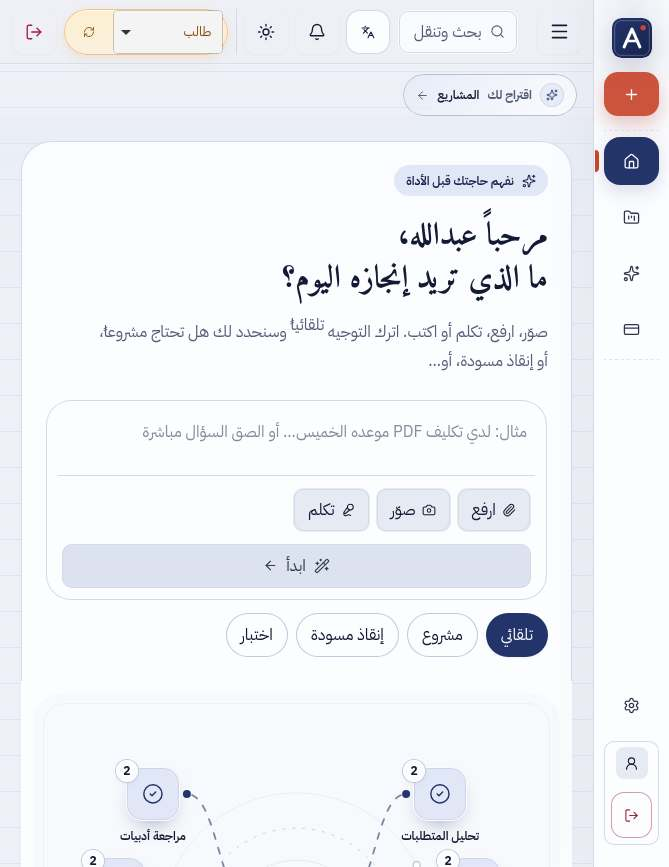 | 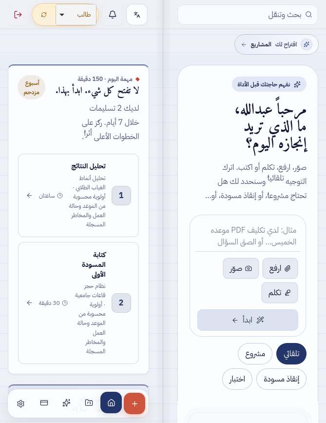 |
| student-home 951x585 | 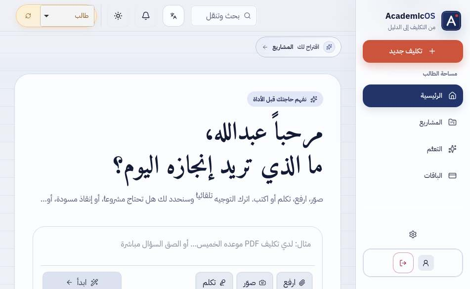 | 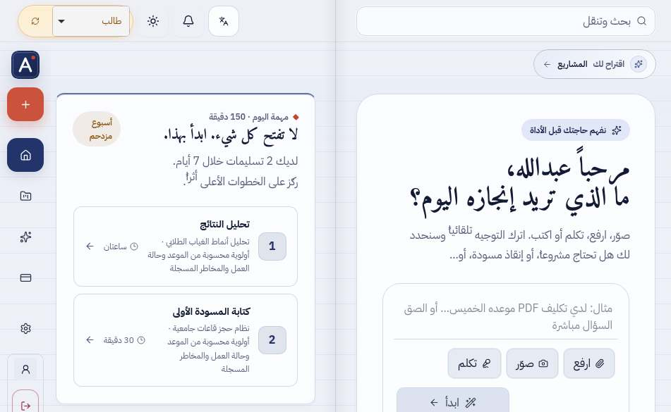 |
| workspace 669x867 | 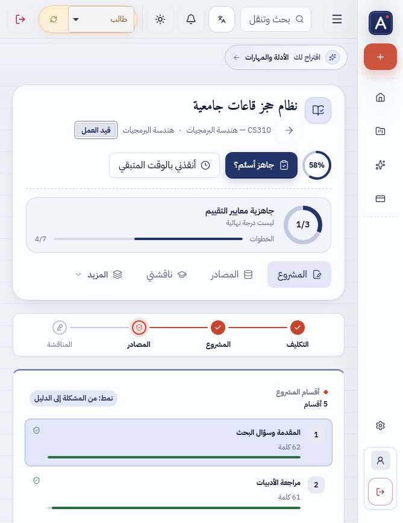 | 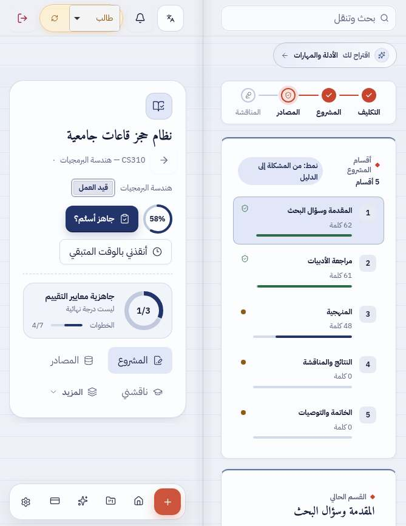 |
| workspace 951x585 | 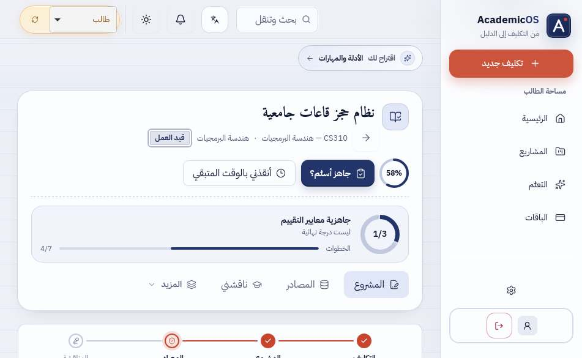 | 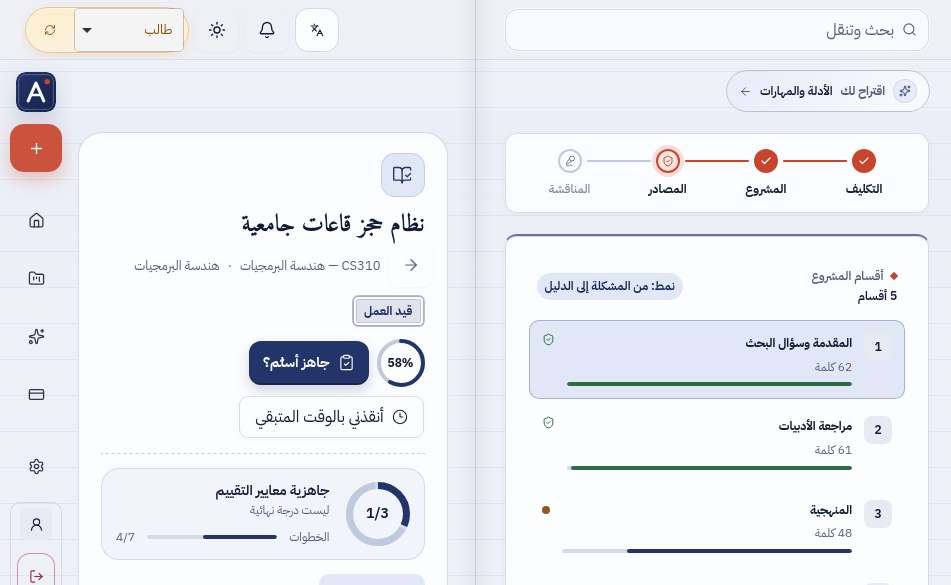 |
| professor-home 669x867 | 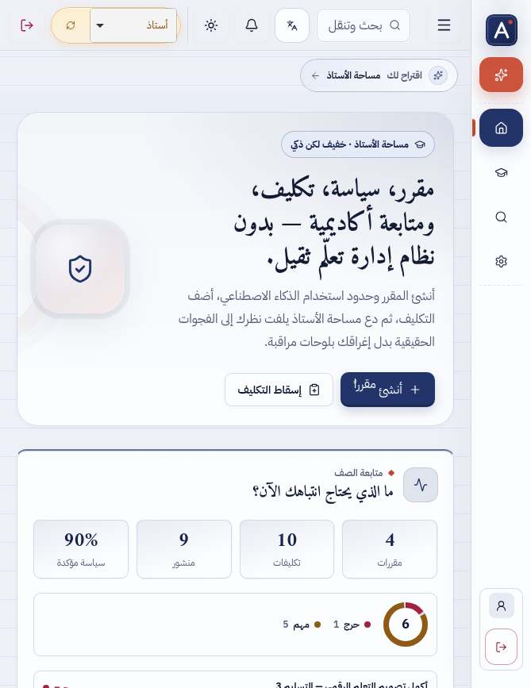 | 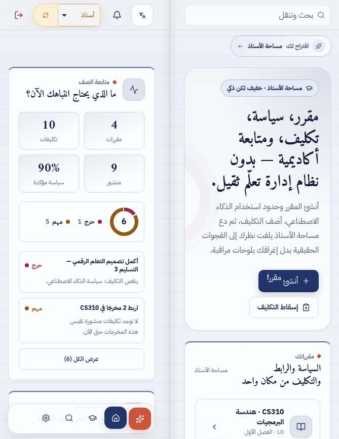 |
| professor-home 951x585 | 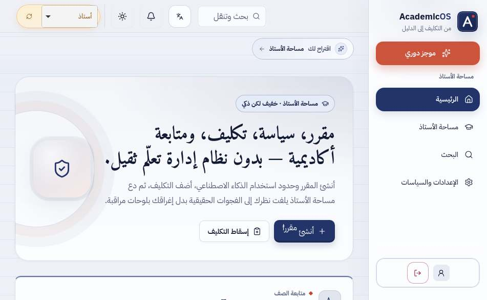 | 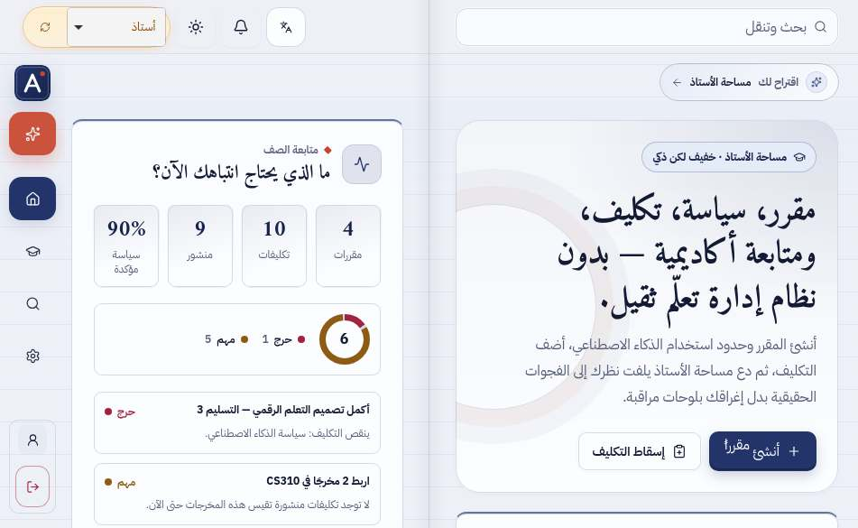 |
| sign-in 669x867 | 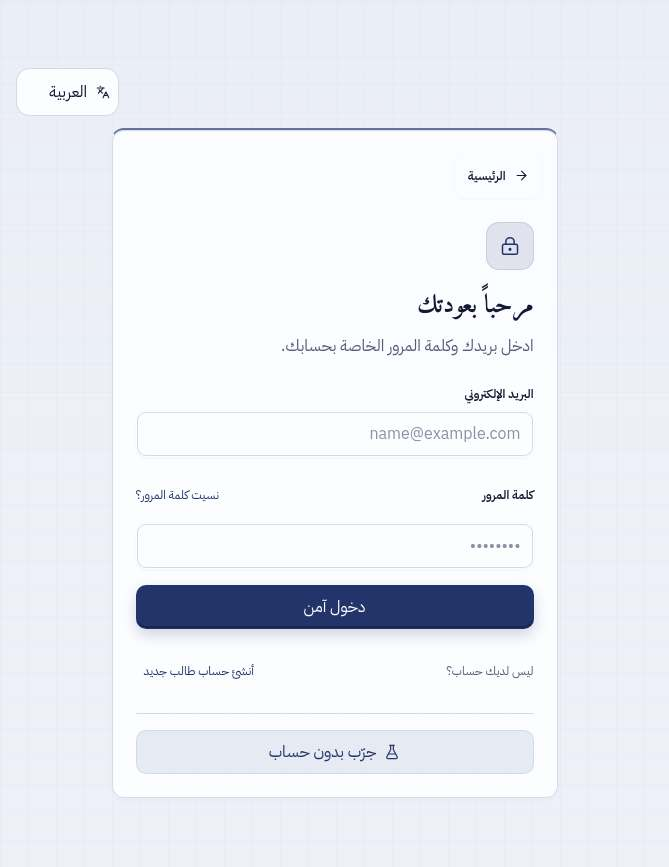 | 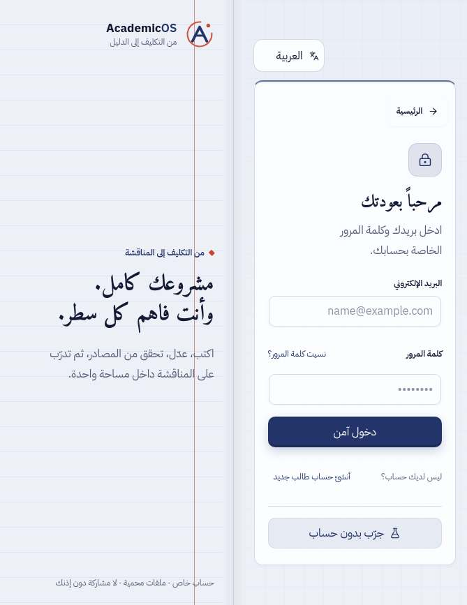 |
| sign-in 951x585 | 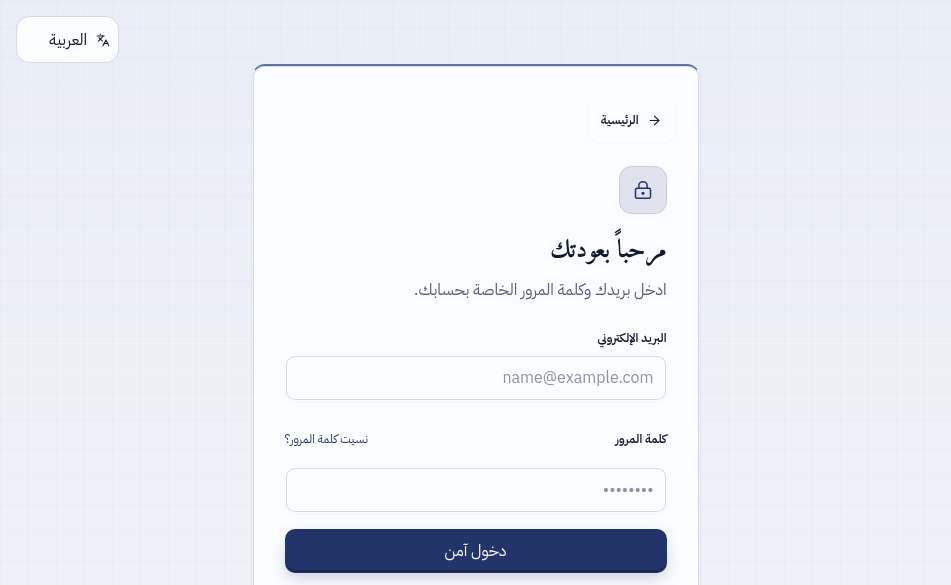 | 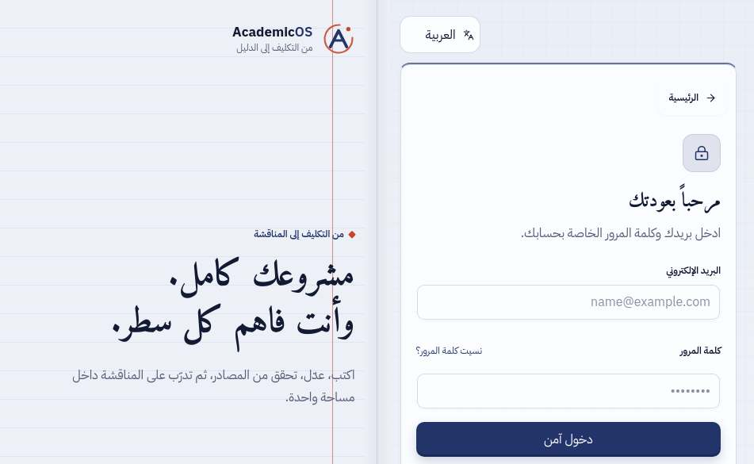 |

WebKit، DPR 1، العربية، البيئة التجريبية.

## 7. الفحوص

| الأمر | النتيجة |
|---|---|
| `npm run audit:launch` (تدقيقات الإطلاق، يعمل في CI) | PASS (26/26 ثوابت واجهة، 0 أخطاء صياغة) |
| `npm run typecheck` / `npm run lint` | PASS |
| `npm run test:ci` | PASS: 234/234 (منها 9 في `tests/duo-layout.test.ts`، 3 جديدة) |
| `npm run build` | PASS |
| `npm run lint:eslint` (تحذيرات فقط، غير حاجب في CI) | 0 أخطاء، 110 تحذيرات |
| `docs/iphone-duo-final/duo-final-audit.cjs` (WebKit) | 86 شاشة، 2236 قياسًا، 0 تمرير أفقي، 0 في الكعب، 0 شاشة خطأ |

لم يُشغَّل نشر، ولا محاكيات Firebase، ولا أي كتابة على الإنتاج.

## 8. قائمة المالك على الجهاز الحقيقي

1. افتح الجهاز كتابًا طوليًا (669×867) على رئيسية الطالب: هل يقع الكعب بين الصفحتين تمامًا فوق المفصل، ولا يمرّ نص أو زر تحته؟ وهل القائمة شريط صغير أسفل الصفحة اليسرى؟
2. اقلبه كتابًا عرضيًا (951×585) على مساحة مشروع: الكاتب يمينًا، ورأس المشروع وتبويباته يسارًا، والقائمة على الحافة اليسرى. مرّر كل صفحة على حدة.
3. افتح «المشاريع» أو «الإعدادات»: القائمة الموسومة صفحة فهرس يسرى.
4. افتح لوحة البحث (⌘K أو زر البحث) في وضع الكتاب: الستار يغطي الشاشتين، واللوحة على اليمنى فقط.
5. اطوِه كاللابتوب (951×350): المحتوى في الأعلى وشريط التحكم في الأسفل، وآخر سطر في الصفحة يظهر فوق الشريط.
6. اكتب نصًا في صندوق الرئيسية ثم اطوِ وافتح عدة مرات: يبقى النص والتحديد.
7. صفحة الدخول مفتوحة: النموذج يمينًا ولوحة «مشروعك كامل» يسارًا.
8. ثبّت التطبيق (PWA) وأعد الخطوات 1–5: هل الحواف بعيدة عن الكاميرا والزوايا؟

## 9. النشر

الدمج في `main` لا ينشر شيئًا. سير العمل [`.github/workflows/deploy-cloud-run.yml`](../.github/workflows/deploy-cloud-run.yml) يعمل بـ`workflow_dispatch` فقط (Actions ← «نشر AcademicOS إلى Cloud Run» ← Run workflow) ويفحص بعد النشر `https://academicos-edu.web.app/` و`/api/health/firestore`. لم يُشغَّل في هذه الجولة.

## 10. إعادة التدقيق

```bash
npm ci && npm run build
NODE_ENV=production PORT=5190 node dist/server.cjs            # منفذ 5190
NODE_PATH=/opt/node22/lib/node_modules PLAYWRIGHT_BROWSERS_PATH=/opt/pw-browsers \
  BASE=http://localhost:5190 node docs/iphone-duo-final/duo-final-audit.cjs --shots=/tmp/duo-shots
# --only=S01,F03 لشاشات محددة، --no-stress لتخطي J
```

الخادم الإنتاجي يرسل HSTS و`upgrade-insecure-requests`؛ السكربت يحذفهما داخل متصفح الاختبار فقط ليعمل `http://localhost`.
